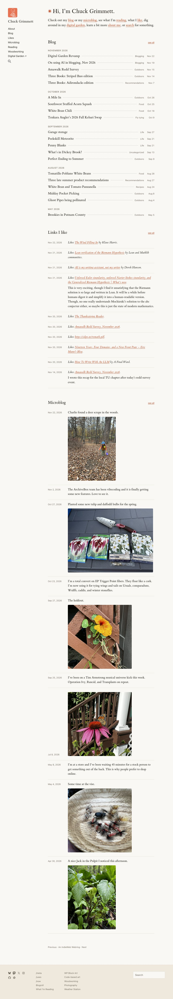

# cagrimmett-com

The WordPress block theme that runs [cagrimmett.com](https://cagrimmett.com). One reading column in ET Book on warm paper, a rust accent, and a narrow sidebar for the name and navigation. It is a sibling to the theme for my [digital garden](https://notes.cagrimmett.com) ([digital-garden-wp](https://github.com/cagrimmett/digital-garden-wp)).

## What's in it

- **Light and dark** schemes that follow the reader's system setting. There is no toggle.
- **Month-grouped post lists**, one line per post, on the homepage and on category, date and search archives.
- **A full-post blog page** and an **all-posts index** split by year with a jump list.
- **Likes and microblog streams** in a date-column layout, built for the [IndieBlocks](https://wordpress.org/plugins/indieblocks/) `indieblocks_like` and `indieblocks_note` post types.
- **Four small hover touches**: the leader between a title and its date ripples, the logo tips, the homepage asterisk turns, and stream links get a wavy underline. All are off under `prefers-reduced-motion`.

The design rules are written down in [DESIGN.md](DESIGN.md).

## Using it

This is a personal theme, published for reference and remixing. It is not a general-purpose theme, and a few things are specific to my site:

- The sidebar and footer reference my navigation menus by ID (`parts/sidebar.html`, `parts/footer.html`). Pick your own in the Site Editor.
- The homepage greeting and links are written into `templates/front-page.html`.
- The blog index is the template for a page with the slug `index` (`templates/page-index.html`).
- Some templates include blocks from IndieBlocks, ActivityPub and Jetpack. Without those plugins the blocks simply don't render.

To try it, copy the folder into `wp-content/themes/` and activate it. It needs WordPress 6.6 or later and has no build step.

### The post index shortcode

The month-grouped list is a shortcode, because the core Query Loop block can't group by date:

| Shortcode | What it lists |
|---|---|
| `[cg_post_index]` | The current archive's posts, with pagination |
| `[cg_post_index count="20" heading="3"]` | The latest 20 posts, with month headings as `h3` |
| `[cg_post_index count="all"]` | Every post, under year headings with a jump list |

## License

The theme is licensed under the [GNU General Public License v2 or later](LICENSE).

It bundles [ET Book](https://github.com/edwardtufte/et-book) by Dmitry Krasny, Bonnie Scranton and Edward Tufte, under the [MIT License](assets/fonts/LICENSE.txt).
